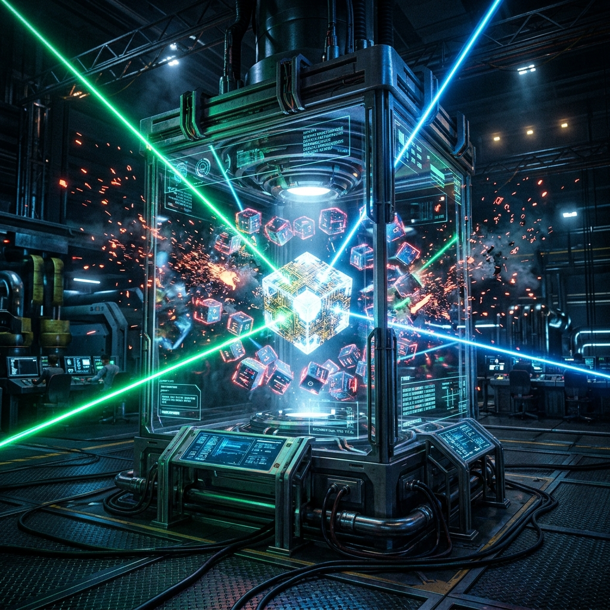
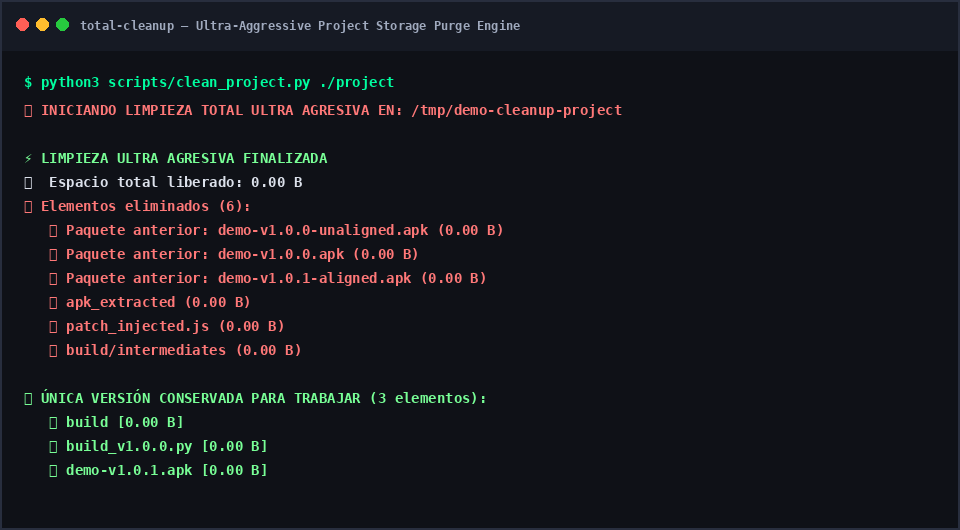

<div align="center">

# 🧹 Total Cleanup
### Ultra-Aggressive Project Storage Purge Engine for Linux & Antigravity 2.0



[](LICENSE)
[](https://github.com/darwinsin822/total-cleanup)
[](#-evidencia-de-ejecución-en-vivo)
[](scripts/ci.sh)

</div>

**Total Cleanup** es el motor ultra agresivo de saneamiento de almacenamiento, purga de residuos de compilación y optimización de disco para proyectos de software en Linux Mint y Google Antigravity 2.0. Elimina sistemáticamente versiones anteriores obsoletas, árboles de descompilación temporal y archivos intermedios, preservando de forma inmutable únicamente el artefacto final activo y el código fuente limpio.

---

## 📊 Evidencia de Ejecución en Vivo

A continuación se muestra una sesión real del motor ejecutando una purga ultra agresiva sobre un entorno de proyecto:

<div align="center">
  
</div>

---

## ⚡ Directivas de Limpieza y Saneamiento

1. **Purga de Paquetes Obsoletos:**
   - Detecta versiones previas de paquetes y binarios (`.apk`, `.deb`, `.AppImage`).
   - Elimina duplicados antiguos y conserva exclusivamente el paquete más reciente.
2. **Purga de Descompilaciones y Scripts Temporales:**
   - Elimina carpetas de descompilación (`apk_extracted/`, carpetas `smali_*` residuales).
   - Purga volcados de JavaScript (`*_injected.js`), volcados de DEX y firmas intermedias (`.idsig`).
   - Limpia cachés de Gradle (`build/intermediates`) y temporales no alineados.
3. **Preservación Inmutable:**
   - Conserva el árbol de código fuente limpio (`src/`) y el artefacto activo productivo.

---

## 🚀 Instalación y Despliegue Rápido

Para instalar la CLI globalmente (`clean-project`) y como skill en Google Antigravity 2.0:

```bash
git clone https://github.com/darwinsin822/total-cleanup.git
cd total-cleanup
./scripts/install.sh
```

Para ejecutar las pruebas deterministas del motor:
```bash
./scripts/ci.sh
```

---

## 💻 Uso de la CLI

```bash
# Limpiar el proyecto en el directorio actual
clean-project .

# Limpiar un proyecto específico
clean-project /ruta/al/proyecto
```

---

## 📄 Licencia

Distribuido bajo la Licencia MIT. Consulta el archivo `LICENSE` para más información.
